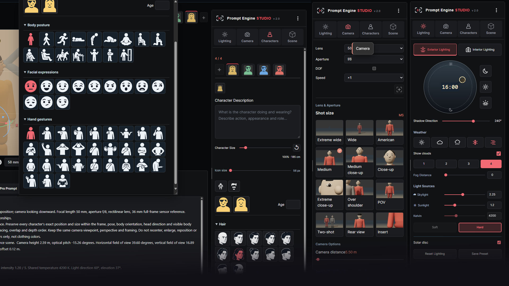
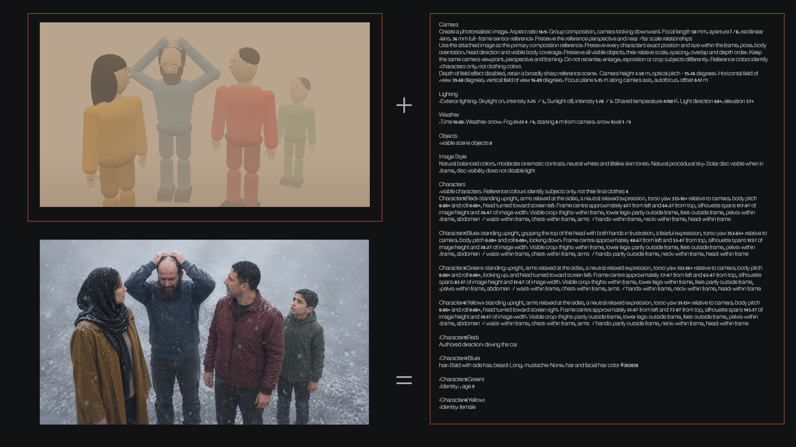

# Prompt Engine STUDIO v2.0

**Build the shot. Capture the reference. Generate the prompt.**

[**Launch Prompt Engine STUDIO in your browser**](https://maxpyan2008.github.io/prompt-engine-studio/) · [العربية](#العربية)

Prompt Engine STUDIO is a browser-based 3D workspace for planning shots and preparing visual references and prompts for AI image generation. Arrange characters and objects, frame the shot, and set the lighting before describing the result in words.

The **reference image** shows the composition, placement, and framing. The **prompt** describes the camera, lighting, focus, and characters. Use both together in your preferred image-generation tool.

## How It Works

1. **Build the scene.** Add characters and objects, then arrange them in the viewport. New elements start at `(0, 0, 0)` and may overlap until you move them.
2. **Direct the characters.** Choose preset poses, rotate the body, and turn or tilt the head. Right-click a character or object to open its properties.
3. **Frame the shot.** Adjust the viewpoint, focal length, and aperture. Use a wide lens to show more of the environment or a longer lens for a narrower field of view.
4. **Set the lighting.** Choose **Exterior**, **Room**, or **Studio** lighting. Adjust its direction while watching how it falls on the scene.
5. **Set the focus.** Enable depth of field when needed, then use **Pick Focus Point** to select a point on a character or object. The prompt includes the selected focus point.
6. **Copy the reference and prompt.** Use both in your image-generation tool to communicate the composition and visual settings.

## Interface Preview

## What You Can Control

- **Camera:** Viewpoint, focal length, aperture, depth of field, and focus point. The Camera panel and the controls below the viewport stay in sync. Enabling depth of field sets the aperture to **f/2.8** as a starting point.
- **Characters:** Preset poses, body orientation, head direction, and custom descriptions. The descriptions you write are included in the prompt.
- **Scene objects:** Move, rotate, and scale objects. Select the **door leaf** to rotate it around its hinge, or the **frame** to move or rotate the entire doorway.
- **Lighting:** Switch between exterior, room, and studio setups. Rotate the lighting group by dragging or using the arrow controls.
- **Workspace:** Choose from **Pro**, **Original**, **Higgsfield**, **Minimal 2.5D**, and **Adobe**. Pro is the default, and the studio remembers your selection. Resize the viewport from its lower edge while keeping the shot’s aspect ratio.
- **Projects:** Open and save `.pes.json` project files from the three-dot menu to return to a shot and continue editing it.

## Viewport Controls

| Action | Control |
| --- | --- |
| Orbit | Left-drag |
| Pan | Middle-drag or Shift + drag |
| Zoom | Mouse wheel |
| Open element properties | Right-click |
| Fine pan and zoom adjustments | Set **Speed** to `×0.5` |

## Online Access and Licensing

The official version runs online in a modern browser with WebGL support. No installation is required.

Free for non-commercial use. Commercial use requires prior written permission from the rights holder. See [LICENSE.md](LICENSE.md) for the project’s terms. Third-party components retain their own licenses.

---

## العربية

**كوّن اللقطة، التقط المرجع، وأنشئ البرومبت.**

[**شغّل Prompt Engine STUDIO من المتصفح**](https://maxpyan2008.github.io/prompt-engine-studio/)

**Prompt Engine STUDIO** هو استوديو ثلاثي الأبعاد لتخطيط اللقطات وإعداد الصور المرجعية والبرومبتات لتوليد الصور بالذكاء الاصطناعي. فكرته أن تبني اللقطة بصريًا قبل وصفها بالكلمات: وزّع الشخصيات والعناصر، واضبط الكاميرا والعدسة والإضاءة، ثم انسخ المرجع والبرومبت.

**الصورة المرجعية** توضّح التكوين ومواضع العناصر وما يظهر داخل الكادر. **البرومبت** يصف إعدادات الكاميرا والإضاءة والتركيز والشخصيات. تستخدمهما معًا في أداة توليد الصور التي تختارها.

### كيف يعمل البرنامج؟

1. **ابنِ المشهد:** أضف الشخصيات والعناصر، ثم وزّعها داخل مساحة العرض. تبدأ العناصر الجديدة عند نقطة الأصل `(0, 0, 0)`، لذلك قد تتراكب إلى أن تنقلها إلى أماكنها.
2. **وجّه الشخصيات:** اختر وضعية جاهزة، واضبط اتجاه الجسم والرأس. انقر بزر الفأرة الأيمن على الشخصية أو العنصر لفتح خصائصه.
3. **كوّن الكادر:** اضبط زاوية الكاميرا والبعد البؤري وفتحة العدسة. استخدم عدسة واسعة لإظهار مساحة أكبر، أو عدسة أطول للحصول على مجال رؤية أضيق.
4. **اضبط الإضاءة:** اختر إضاءة خارجية **Exterior**، أو إضاءة غرفة **Room**، أو إضاءة استوديو **Studio**. غيّر اتجاه الضوء وراقب أثره على المشهد.
5. **حدّد نقطة التركيز:** فعّل عمق الميدان عند الحاجة، واستخدم **Pick Focus Point** لاختيار نقطة على شخصية أو عنصر. تظهر نقطة التركيز في البرومبت.
6. **انسخ المرجع والبرومبت:** استخدمهما معًا في أداة توليد الصور لنقل التكوين والإعدادات البصرية.

### أدوات التحكم

- **الكاميرا:** زاوية العرض، والبعد البؤري، وفتحة العدسة، وعمق الميدان، ونقطة التركيز. تتزامن لوحة الكاميرا مع الشريط أسفل مساحة العرض. عند تفعيل عمق الميدان، تبدأ فتحة العدسة من **f/2.8**.
- **الشخصيات:** وضعيات جاهزة، وتوجيه الجسم والرأس، ووصف مخصص لكل شخصية يظهر في البرومبت.
- **عناصر المشهد:** تحريك العناصر وتدويرها وتحجيمها. حدّد **ضلفة الباب** لتدويرها حول المفصلة، أو **الإطار** لتحريك الباب كاملًا أو تدويره.
- **الإضاءة:** التبديل بين إضاءة الخارج والغرفة والاستوديو، وتدوير مجموعة الإضاءة بالسحب أو باستخدام الأسهم.
- **واجهة العمل:** خمسة مظاهر: **Pro** و**Original** و**Higgsfield** و**Minimal 2.5D** و**Adobe**. يبدأ البرنامج بمظهر **Pro** ويحفظ اختيارك. يمكنك تحجيم مساحة العرض من الحافة السفلية مع الحفاظ على نسبة أبعاد اللقطة.
- **المشاريع:** افتح المشاريع واحفظها بصيغة `.pes.json` من قائمة النقاط الثلاث للعودة إلى اللقطة ومتابعة تعديلها.

### التحكم داخل مساحة العرض

| الإجراء | طريقة التحكم |
| --- | --- |
| تدوير زاوية العرض | السحب بزر الفأرة الأيسر |
| إزاحة العرض | السحب بزر الفأرة الأوسط أو الضغط على `Shift` مع السحب |
| التقريب والإبعاد | عجلة الفأرة |
| فتح خصائص شخصية أو عنصر | النقر بزر الفأرة الأيمن |
| ضبط الإزاحة والتقريب بدقة أكبر | اختيار `×0.5` من إعداد **Speed** |

### التشغيل والترخيص

النسخة الرسمية متاحة للتشغيل عبر الإنترنت من متصفح حديث يدعم WebGL، ولا تتطلب تثبيتًا.

الاستخدام غير التجاري مجاني. يتطلب الاستخدام التجاري موافقة خطية مسبقة من صاحب الحقوق. راجع [ملف الترخيص](LICENSE.md) للاطلاع على الشروط. تحتفظ المكتبات والأصول التابعة للغير بتراخيصها الخاصة.

اللهم صل على محمد وآل محمد.

**تصميم: — Bagher Badri**  
بغداد، 2026 · [Telegram: @badri_director](https://t.me/badri_director)
