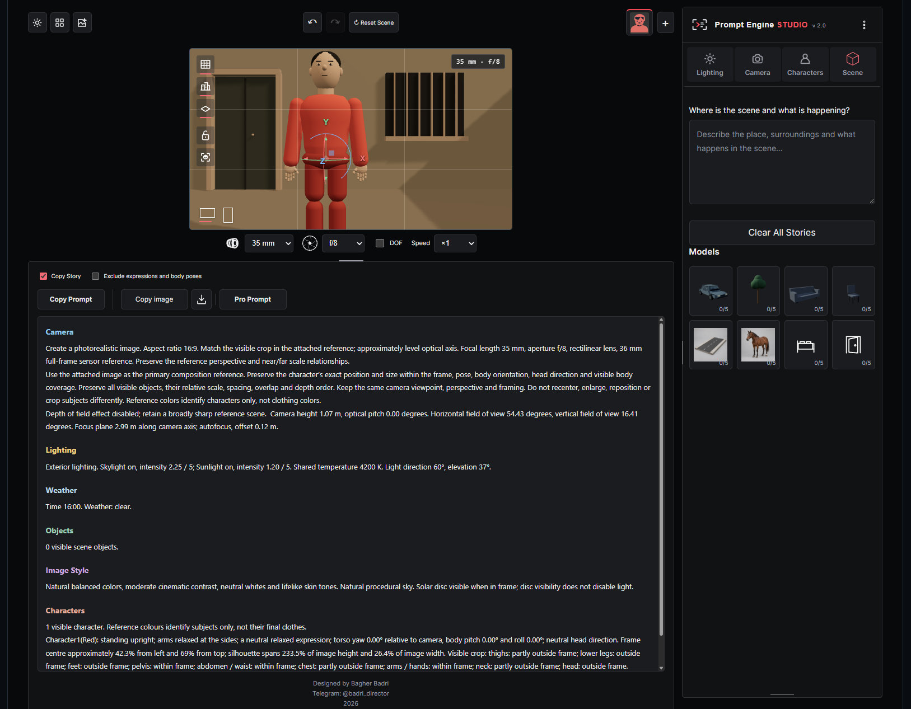

# Prompt Engine STUDIO v2.0 

**Build the shot. Capture the reference. Generate the prompt.**

Prompt Engine STUDIO is a browser-based 3D workspace for planning shots and preparing visual references and prompts for AI image generation.

The idea is simple: instead of describing a shot from scratch, you build it visually. Place your characters and objects, choose the camera angle and lens, set the lighting, and see how those decisions work together in the viewport. The studio then turns the shot setup into a structured prompt that you can use alongside the reference image.

The reference shows **where everything is and how the shot is framed**. The prompt explains **what the image should depict and which visual decisions should carry through**. The studio prepares these inputs; the final image is generated in the AI tool of your choice.

## How It Works

1. **Build the scene.** Add characters and objects, then arrange them in the viewport. New elements start at the scene origin `(0, 0, 0)`, so move them into position if they overlap.
2. **Direct the characters.** Choose preset poses, adjust body orientation, and turn or tilt the head to direct the character’s gaze. Right-click an element to access its properties.
3. **Frame the shot.** Set the viewpoint, focal length, and aperture. Use a wide lens to include more of the environment or a longer lens to isolate a tighter view. Check the relationship between the foreground, subjects, and background in the viewport.
4. **Set the lighting.** Choose **Exterior**, **Room**, or **Studio** lighting. Adjust the direction to see how the light falls across faces, props, and the scene.
5. **Set the focus.** Enable depth of field when the shot calls for it. Use **Pick Focus Point** to select a point on a character or object. The selected point is also described in the generated prompt.
6. **Copy the reference and prompt.** Use both together in your image-generation tool. The reference carries the composition; the prompt carries the camera, lighting, focus, and character instructions.

## What You Can Control

- **Camera:** Viewpoint, focal length, aperture, depth of field, and focus point. The Camera panel and the controls below the viewport stay in sync. Enabling depth of field sets the aperture to **f/2.8** as a starting point.
- **Characters:** Preset poses, body orientation, head direction, and your own character descriptions. The prompt includes the description you write.
- **Scene objects:** Place, move, rotate, and scale objects. For doors, select the **door leaf** to rotate it around its hinge, or select the **frame** to move or rotate the whole doorway.
- **Lighting:** Switch between exterior, room, and studio setups. Rotate the lighting group with a drag or the arrow controls. Studio presets stay collapsed until you open them.
- **Workspace:** Choose from five interface themes: **Pro**, **Original**, **Higgsfield**, **Minimal 2.5D**, and **Adobe**. Pro is the default, and the studio remembers your selection. Resize the viewport from its lower edge while keeping the shot’s aspect ratio.
- **Projects:** Open and save `.pes.json` files from the three-dot menu. Use these files to return to a shot and continue editing it.

## Viewport Controls

| Action | Control |
| --- | --- |
| Orbit the view | Left-drag |
| Pan the view | Middle-drag or Shift + drag |
| Zoom | Mouse wheel |
| Open element properties | Right-click |
| Make finer pan and zoom adjustments | Set **Speed** to `×0.5` |

## Run the Studio

**Online:** [Open Prompt Engine STUDIO](https://maxpyan2008.github.io/prompt-engine-studio/) once GitHub Pages is enabled.

**Locally from the release ZIP:** Extract the full archive and keep its folder structure intact. On Windows, run `Start-STUDIO.bat` from the main folder. On other systems, run `python3 program/run_studio.py` from the main folder. Local operation requires Python 3 and a modern browser with WebGL support. Keep the launcher window open while you work.

## Usage and Licensing

Free for non-commercial use. Commercial use requires prior written permission from the rights holder. See [LICENSE.md](LICENSE.md) for the project’s terms. Third-party components retain their own licenses.

**Designed by Bagher Badri**  
Baghdad, 2026 · [Telegram: @badri_director](https://t.me/badri_director)
# Prompt Engine STUDIO v2.0 — Build 67

**كوّن اللقطة، التقط المرجع، وأنشئ البرومبت.**

**Prompt Engine STUDIO** هو استوديو ثلاثي الأبعاد يعمل داخل المتصفح، يساعدك على تخطيط اللقطات وإعداد الصور المرجعية والبرومبتات لتوليد الصور بالذكاء الاصطناعي.

تبدأ فكرة البرنامج من سؤال بسيط: لماذا نحاول وصف اللقطة بالكلمات قبل أن نراها؟ في الاستوديو، تبني اللقطة بصريًا أولًا: تضع الشخصيات والعناصر، وتختار زاوية الكاميرا والعدسة، وتضبط الإضاءة. وعندما تصل إلى التكوين المطلوب، تنسخ صورة مرجعية وبرومبت منظّم يصف إعدادات اللقطة.

**الصورة المرجعية** تبيّن أين تقف الشخصيات، وكيف تتوزع العناصر، وما الذي يظهر داخل الكادر. **البرومبت** يشرح ما تريد أن يظهر في الصورة النهائية، من وصف الشخصيات إلى تفاصيل الكاميرا والإضاءة والتركيز. تستخدم الاثنين معًا في أداة توليد الصور التي تختارها؛ فالاستوديو يهيّئ اللقطة، وتولّد الأداة الأخرى الصورة النهائية.

## كيف يعمل البرنامج؟

1. **ابنِ المشهد:** أضف الشخصيات والعناصر، ثم وزّعها داخل مساحة العرض. تبدأ العناصر الجديدة عند نقطة الأصل `(0, 0, 0)`، لذلك قد تتراكب حتى تنقلها إلى أماكنها.
2. **وجّه الشخصيات:** اختر وضعية جاهزة، واضبط اتجاه الجسم، وحرّك الرأس أفقيًا أو عموديًا لتوجيه النظرة. انقر بزر الفأرة الأيمن على الشخصية أو العنصر لفتح خصائصه.
3. **كوّن الكادر:** اضبط موضع الكاميرا وزاويتها والبعد البؤري وفتحة العدسة. جرّب عدسة واسعة لإظهار مساحة أكبر من المكان، أو عدسة أطول للحصول على مجال رؤية أضيق. راقب العلاقة بين المقدمة والشخصيات والخلفية أثناء الضبط.
4. **اضبط الإضاءة:** اختر إضاءة خارجية أو إضاءة غرفة أو استوديو. غيّر اتجاه الإضاءة لترى أثرها على الوجوه والعناصر داخل المشهد.
5. **حدّد نقطة التركيز:** فعّل عمق الميدان عند الحاجة، واستخدم **Pick Focus Point** لاختيار نقطة على شخصية أو عنصر. يذكر البرومبت نقطة التركيز المحددة.
6. **انسخ المرجع والبرومبت:** استخدمهما معًا في أداة توليد الصور. المرجع يوضّح التكوين، والبرومبت ينقل الوصف والإعدادات البصرية التي تريد الحفاظ عليها.

## أدوات التحكم

- **الكاميرا:** موضع الكاميرا وزاويتها، والبعد البؤري، وفتحة العدسة، وعمق الميدان، ونقطة التركيز. تتزامن لوحة الكاميرا مع الشريط أسفل مساحة العرض. عند تفعيل عمق الميدان، تُضبط فتحة العدسة على **f/2.8** كنقطة بداية.
- **الشخصيات:** وضعيات جاهزة، وتوجيه الجسم والرأس، وإضافة وصف خاص بكل شخصية. ينتقل الوصف الذي تكتبه إلى البرومبت.
- **عناصر المشهد:** تحريك العناصر وتدويرها وتحجيمها. في الأبواب، يمكنك تحديد **ضلفة الباب** لتدويرها حول المفصلة، أو تحديد **الإطار** لتحريك الباب كاملًا أو تدويره.
- **الإضاءة:** ثلاثة أوضاع: **Exterior** و**Room** و**Studio**. يمكنك تدوير مجموعة الإضاءة بالسحب أو باستخدام الأسهم. تبقى إعدادات الاستوديو الجاهزة مطوية حتى تفتحها.
- **واجهة العمل:** خمسة مظاهر: **Pro** و**Original** و**Higgsfield** و**Minimal 2.5D** و**Adobe**. يبدأ البرنامج بمظهر **Pro** ويحفظ اختيارك لاحقًا. يمكنك تحجيم مساحة العرض من الحافة السفلية مع الحفاظ على نسبة أبعاد اللقطة.
- **المشاريع:** افتح المشاريع واحفظها بصيغة `.pes.json` من قائمة النقاط الثلاث، حتى تتمكن من العودة إلى اللقطة ومتابعة تعديلها.

## التحكم داخل مساحة العرض

| الإجراء | طريقة التحكم |
| --- | --- |
| تدوير زاوية العرض حول المشهد | السحب بزر الفأرة الأيسر |
| إزاحة العرض | السحب بزر الفأرة الأوسط أو `Shift` مع السحب |
| التقريب والإبعاد | عجلة الفأرة |
| فتح خصائص الشخصية أو العنصر | النقر بزر الفأرة الأيمن |
| ضبط الإزاحة والتقريب بدقة أكبر | اختر `×0.5` من إعداد **Speed** |

## تشغيل البرنامج

**عبر الإنترنت:** [افتح Prompt Engine STUDIO](https://maxpyan2008.github.io/prompt-engine-studio/) بعد تفعيل GitHub Pages.

**على جهازك:** فك ضغط نسخة الإصدار كاملةً وحافظ على ترتيب الملفات والمجلدات. على Windows، شغّل `Start-STUDIO.bat` من المجلد الرئيسي. على الأنظمة الأخرى، نفّذ `python3 program/run_studio.py` من المجلد الرئيسي. يتطلب التشغيل المحلي Python 3 ومتصفحًا حديثًا يدعم WebGL. اترك نافذة التشغيل مفتوحة أثناء العمل.

## الاستخدام والترخيص

الاستخدام غير التجاري مجاني. يتطلب الاستخدام التجاري موافقة خطية مسبقة من صاحب الحقوق. راجع [ملف الترخيص](LICENSE.md) للاطلاع على الشروط. تحتفظ المكتبات والأصول التابعة للغير بتراخيصها الخاصة.

**تصميم: باقر البدري — Bagher Badri**  
بغداد، 2026 · [Telegram: @badri_director](https://t.me/badri_director)
